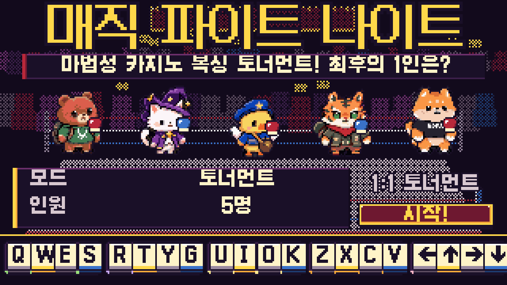
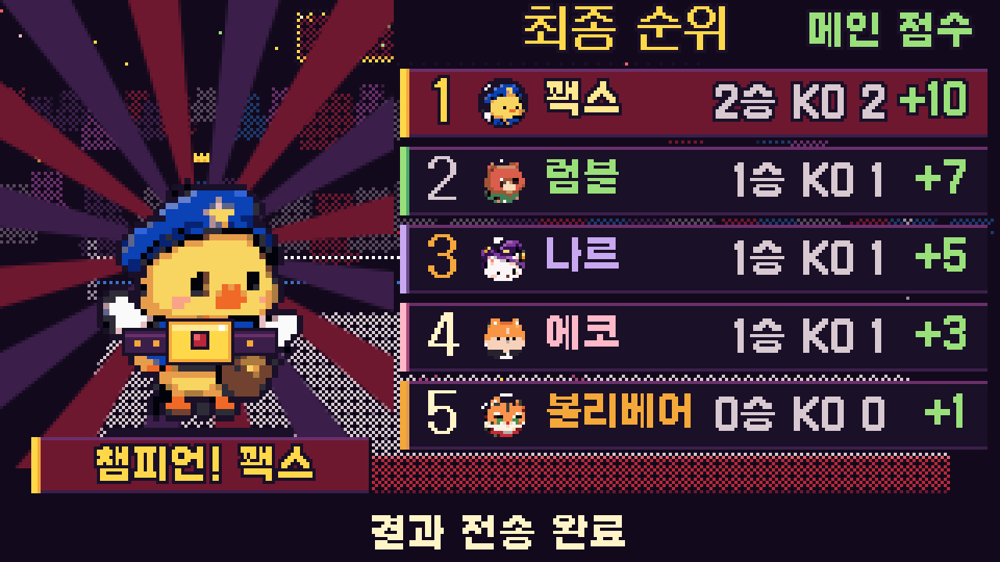
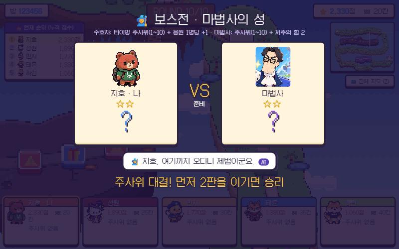

# RE:ROLL 🎲
### AI-Powered 5-Player Fantasy Party Game

> 승부는 미니게임에서, 역전은 주사위에서.


[🎮 게임 플레이](https://reroll-party.onrender.com/party/) · [🎬 오프닝 영상](party-python/board/assets/intro.mp4) · [📖 미니게임 통신 규격](party-python/docs/COMMON_SPEC.md)

RE:ROLL은 **5명이 각자의 기기에서 참여하는 2D 판타지 파티게임**입니다. 주사위로 보드 위를 이동하고 이벤트를 경험하며, 다양한 AI 기술을 활용한 **미니게임 20종 중 무작위로 선정되는 게임**을 통해 점수를 쌓습니다. **매 라운드 탈락자는 없으며 다섯 명 모두 끝까지 플레이합니다.** 게임 종료 시 **누적 점수 1위가 마법사 보스전에 진출**하고 승패에 따라 엔딩이 달라집니다.

> [!NOTE]
> Render 무료 배포 환경에서는 장시간 접속이 없으면 서버가 중지되어 첫 접속에 시간이 걸릴 수 있습니다. 카메라·마이크를 사용하는 미니게임은 브라우저 권한 허용이 필요합니다.

---

## 🪄 세계관 · 스토리

평화로운 마을에 사람들이 동물로 변하는 저주가 퍼집니다. 저주에 걸린 다섯 수호자—쿼카를 닮은 곰, 호랑이, 오리, 고양이, 시바견—는 마을을 되돌릴 방법을 찾아 마법사의 성으로 향합니다.

하지만 수호자들이 의지하려던 마법사가 바로 **저주를 만들어 낸 장본인**. 수호자들은 마법사가 준비한 주사위와 미니게임을 거치며 운명을 건 대결에 뛰어듭니다.

- **GOOD ENDING:** 최종 1위가 마법사를 이기고 저주를 풀어 마을 사람들이 인간의 모습으로 돌아옵니다.
- **BAD ENDING:** 마법사를 이기지 못하면 저주는 계속되고, 마법사는 새로운 수호자들을 기다리며 다음 게임을 준비합니다.

## 🗺️ 게임 진행 흐름

```text
타이틀 화면 (시작하려면 터치하세요)
  ↓
스토리 오프닝 영상 (SKIP 가능)
  ↓
방 만들기 / 팀 코드 입력 / 5인 대기실 / 캐릭터 선택
  ↓
주사위 굴리기 → 보드 이동 → 타일 이벤트
  ↓
랜덤 미니게임 → 플레이어별 결과 → 누적 점수 반영
  ↓
다음 턴 · 새로운 이벤트 · 새로운 미니게임 (전원 계속 참여)
  ↓
전체 게임 종료 → 누적 점수 최종 1위 결정
  ↓
최종 1위 vs 마법사 보스전
  ├─ 승리 → GOOD ENDING
  └─ 패배 → BAD ENDING
```

### 핵심 규칙

| 구분 | 내용 |
| --- | --- |
| 참가 방식 | 5인 멀티플레이, 각자 브라우저에서 접속 |
| 플레이 방식 | 보드 이벤트 + 랜덤 선정 미니게임 |
| 미니게임 규모 | 20종 등록, 매 게임 일부를 선정해 진행 |
| 경쟁 방식 | 동시 경쟁, 개인별 점수 비교, 팀 대결 등 게임마다 다름 |
| 탈락 | **라운드별 탈락 없음. 5명 모두 끝까지 참여** |
| 최종 진출 | **누적 점수 1위만 마법사 보스전 도전** |
| 엔딩 | 보스전 승패에 따라 굿 엔딩 / 배드 엔딩 |

## 🧠 AI와 게임플레이

게임마다 조작법과 판정 기준을 다르게 설계했습니다. 단순히 게임 수만 많은 것이 아니라 **말하기·손동작·그림·리듬·대결·타이밍** 등 매 게임의 상호작용 방식을 다르게 구성했습니다. AI가 판단하는 까다로운 기준과 난도가 도전 및 경쟁의 재미로 이어지도록 기획했으며, 데모 테스트에서도 경쟁심을 자극하는 플레이 경험을 확인했습니다.

| 유형 | 적용 예시 |
| --- | --- |
| 🎤 음성 인식 | 음성 퀴즈, 주문을 외쳐라, 소리 따라하기 |
| ✋ 카메라·동작 인식 | 과일자르기, 가든 디펜스, 레이싱의 카메라 입력 |
| 🎨 그리기 | 마법진 그리기 |
| 🎵 타이밍·리듬 | 잭팟 그루브, 픽셀 줄다리기 |
| 🥊 대결·반응 | 손바닥 밀치기, 매직 파이트 나이트, 검도 |
| 🎲 파티게임 | 인형뽑기, 볼링, 홈런 더비, 하노마노 등 |

### 미니게임 20종

| | 게임 | | 게임 |
| --- | --- | --- | --- |
| 01 | 픽셀 줄다리기 | 11 | 잭팟 인형뽑기 |
| 02 | 손바닥 밀치기 | 12 | 매직 파이트 나이트 |
| 03 | 음성 퀴즈 | 13 | 하노마노 |
| 04 | 주문을 외쳐라 | 14 | 잭팟 볼링 |
| 05 | 무궁화 꽃이 피었습니다 | 15 | 잭팟 그루브 |
| 06 | 소리 따라하기 | 16 | 잭팟 홈런 더비 |
| 07 | 과일자르기 | 17 | 실거리 사격 |
| 08 | 가든 디펜스 | 18 | 마법진 그리기 |
| 09 | 검도 | 19 | 잭팟 탁구왕 |
| 10 | 레이싱 | 20 | 교수님 몰래 댄스! |

미니게임 목록은 실제 게임 등록 파일 [`party-python/web/src/games/registry.js`](party-python/web/src/games/registry.js)를 기준으로 작성했습니다. 미니게임의 AI 적용 방식과 입력 장치는 게임별로 다르며, 카메라나 마이크 대신 키보드로 대체 가능한 게임도 있습니다.

## 🎬 최종 발표 · 플레이 시연 영상

**RE:ROLL 최종 발표 영상 · 03:48 · Full HD (1920 × 1080)**

최종 발표 영상에는 **마법사와 저주의 세계관을 소개하는 오프닝**, 실제 미니게임의 조작과 경쟁 장면, 5인 결과 화면, 엔딩 연출이 포함되어 있습니다. 개별 장면뿐 아니라 **게임 플레이와 결과가 하나의 흐름으로 연결되는 과정**을 확인할 수 있습니다.

> [!NOTE]
> 최종 발표 영상 원본: `RE-ROLL발표영상.mp4` (팀에서 별도 보관). 영상 파일은 제공받았지만 아직 GitHub에서 접근할 수 있는 공개 URL로 게시되지 않았으므로, 이 README에 재생되지 않는 링크를 임의로 만들지 않았습니다. 공개 영상 업로드 후 이 위치에 링크 또는 썸네일을 연결하면 됩니다. 아래에는 저장소에 업로드된 실제 오프닝·엔딩 영상과 장면 스크린샷을 바로 볼 수 있도록 연결했습니다.

## 📸 게임 화면 미리보기

### 메인 이미지와 미니게임

| 메인 비주얼 | 미니게임 화면 예시 (매직 파이트 나이트) |
| :---: | :---: |
|  |  |

| 미니게임 결과 화면 예시 | 최종 순위 화면 |
| :---: | :---: |
|  |  |

### 보스전과 두 가지 엔딩

| 보스전 진입 | GOOD ENDING | BAD ENDING |
| :---: | :---: | :---: |
|  |  |  |

### 🎬 실제 저장소의 영상 자료

- [오프닝 애니메이션 보기 — intro.mp4](party-python/board/assets/intro.mp4)
- [굿 엔딩 애니메이션 보기 — ending-good.mp4](party-python/board/assets/ending-good.mp4)
- [배드 엔딩 애니메이션 보기 — ending-bad.mp4](party-python/board/assets/ending-bad.mp4)

> 오프닝·엔딩 영상은 GitHub 저장소의 실제 MP4 링크입니다. **3분 48초 최종 발표/플레이 영상은 별도로 제공받았으며**, GitHub에서 재생할 수 있는 공개 업로드 링크가 준비되면 상단 발표 영상 섹션에 추가할 수 있습니다.

## 🛠️ 기술 스택

| 영역 | 기술 / 도구 | 적용 내용 |
| --- | --- | --- |
| Frontend | JavaScript, HTML, CSS, Vite | 보드 · 로비 · 미니게임 UI |
| Backend | Python, FastAPI, Uvicorn | 서버 API · 게임 상태 · 미니게임 판정 |
| 실시간 통신 | WebSocket | 방 및 플레이어 상태, 게임 진행 동기화 |
| 컴퓨터 비전 | MediaPipe Hand Landmarker | 손 모양, 손가락, 핸들 조작 등 브라우저 입력 |
| 음성 AI | Hugging Face Whisper(로컬), Gemini STT(배포 환경) | 음성 퀴즈 · 주문 · 소리 인식 |
| 생성형 AI | Gemini API | 문제 생성, 음성 처리 및 게임 기능 연동 |
| AI 영상 | Hugging Face Wan 2.2, PixVerse | 캐릭터/배경 이미지의 영상화, 스토리 컷 연출 |
| AI 음향 | Suno AI | 게임 및 발표 영상용 배경음악 제작 |
| 배포 · 협업 | Docker, Render, GitHub | 웹 서비스 배포와 팀 개발 |

AI 기능은 각 미니게임의 구현 방식과 배포 환경에 따라 사용 모델 및 대체 입력 방식이 다릅니다. 모델과 실행 규칙은 개별 게임 코드에서 확인할 수 있습니다.

## 👥 팀 구성 및 역할

다양한 미니게임을 개별 제작한 뒤, **공통 규격으로 멀티플레이 전환 → 메인 보드 및 UI·UX 연결 → 최종 통합·검증·발표** 순서로 개발했습니다.

| 팀원 | 담당 영역 | 주요 역할 및 기여 | 제작/작업 자료 |
| --- | --- | --- | --- |
| **동주** | 미니게임 기획·제작 | 미니게임 10종 제작, 개별 게임 규칙·조작 및 초기 테스트 | [게임 제작 Artifact](https://claude.ai/artifact/LCLqyXcBWR8hSutHTMmWZ7) |
| **용학** | 미니게임 기획·제작 | 미니게임 10종 제작, 다양한 게임 메커니즘·AI 기능 및 초기 테스트 | [게임 제작 Artifact](https://claude.ai/artifact/JebqUhLw1YpmpoTUAsdKXh#fruit) |
| **민재** | 게임 AI 기능 및 검수 | 미니게임 AI 요소 적용·보완, 개별 게임 정비, 통합 전 2차 검수와 테스트 | [게임·AI 작업 Artifact](https://claude.ai/artifact/7Qy12WYyZLsGHzZepbNA9N#sori) |
| **대환** | **서버 판정 · 멀티플레이 전환** | 기존 게임 10종의 서버 판정 전환, 2~5인 네트워크 플레이, 공통 WebSocket 규격 및 상태 동기화, 재접속·결과 전송·서버 테스트 | [공통 통신 규격](party-python/docs/COMMON_SPEC.md) |
| **세은 (팀장)** | **UI·UX · 영상/음향 · 최종 통합/발표** | 전체 게임 경험·화면 흐름 설계, 스토리보드, 타이틀·로비·보드·엔딩의 UI·UX, 생성형 AI 영상·음악 제작, 통합 점검·최종 테스트 및 발표 자료·시연 영상 준비 | [인트로 영상](party-python/board/assets/intro.mp4) · [굿 엔딩](party-python/board/assets/ending-good.mp4) · [배드 엔딩](party-python/board/assets/ending-bad.mp4) |

### 🔌 서버 판정 · 멀티플레이 전환 (대환)

기존에 한 화면 또는 CPU 상대 중심으로 진행되던 **10개 미니게임을 2~5명 각자의 브라우저에서 플레이할 수 있도록 재구성**했습니다. 팀의 최종 게임 목표 인원은 5명입니다.

- **Python FastAPI + WebSocket:** 참가자 입장·게임 시작·종료·재접속·결과 전송을 관리하는 공통 서버 구축
- **서버 권한 판정:** 브라우저는 키·손동작·음성 등의 입력을 보내고, 점수·승패·순위는 서버에서 계산
- **게임 10종 전환:** 픽셀 줄다리기, 손바닥 밀치기, 음성 퀴즈, 주문을 외쳐라, 무궁화 꽃이 피었습니다, 소리 따라하기, 과일자르기, 가든 디펜스, 검도, 레이싱
- **공용 AI 모듈:** Whisper 음성 인식/소리 채점, Gemini 문제 생성, MediaPipe 손 인식 및 대체 입력
- **검증:** 작업 문서 기준 **2026-11-18 당시** 서버 판정 자동 테스트 180개, 원본 줄다리기 비교 테스트 85개 통과. 당시 여러 실제 기기에서의 동시 접속·인식 검증 등은 추가 작업으로 남아 있었음

서버 역할과 원본 게임을 **새로 만든 역할은 구분**했습니다. 위 10종은 대환이 기존 게임을 서버 판정·멀티플레이 구조로 전환한 범위이며, 팀의 전체 게임 제작은 동주·용학·민재의 미니게임 작업을 바탕으로 진행했습니다.

### 🎨 UI·UX · 스토리·AI 콘텐츠 · 통합 (세은)

- **게임 경험 설계:** 플레이어가 타이틀에서 인트로·방 입장·로비·주사위·보드·미니게임·누적 순위·보스전·엔딩으로 자연스럽게 이어지도록 화면 구성과 흐름 설계
- **스토리텔링:** 저주받은 다섯 수호자와 마법사를 중심으로 세계관, 인트로, 굿/배드 엔딩, 컷별 스토리보드 기획
- **생성형 AI 영상:** **Hugging Face Wan 2.2** 및 **PixVerse**를 활용해 이미지 기반 장면을 동적인 판타지 연출로 변환하고 영상 편집에 활용
- **AI 음악 제작:** **Suno AI**를 이용해 게임 및 영상에 사용할 음악을 기획·제작
- **프로젝트 마무리:** 전체 UI·UX 일관성 점검, 서버·미니게임 연결 상태 확인, 최종 테스트 및 오류 점검, 발표 스토리 구성과 시연 영상·발표 자료 준비

### 🧪 개발·검증 과정

1. **게임 제작:** 동주·용학의 개별 미니게임 제작, 민재의 AI 보완 및 2차 검수
2. **멀티플레이 통합:** 대환의 서버 판정 전환, 공통 게임 규격, 2~5인 접속 지원 및 자동 테스트
3. **게임 경험 통합:** 세은의 UI·UX, 메인 보드·인트로·엔딩, 영상 및 음향 리소스 연결
4. **최종 점검·발표:** 5인 실제 플레이, 동기화·점수·AI 인식·진행 흐름 검증, 시연 영상 및 발표 준비

> 팀원별 Claude Artifact 링크는 작업·시연 자료입니다. 링크 공개 설정에 따라 로그인 또는 접근 권한이 필요할 수 있으며, 저장소에 포함된 최종 통합 버전과 일부 동작이 다를 수 있습니다.

## 🗂️ 저장소 구조

```text
RE-ROLL/
├── README.md
├── party-python/          # 현재 Render 배포 기준 통합 프로젝트
│   ├── board/             # 메인 화면 · 보드 · 인트로 · 보스전 · 엔딩
│   │   └── assets/        # keyart, 캐릭터, intro/ending 영상
│   ├── web/               # Vite 기반 미니게임 프론트엔드
│   │   └── src/games/     # 미니게임 20종 등록 및 화면 구현
│   ├── server/            # FastAPI · WebSocket · 게임 판정
│   └── docs/              # 통신 규격 · 배포 문서 · 화면 자료
├── party/                 # 별도 보드 UI 구현
├── server/                # Node 기반 별도 서버 구현
├── minigame-KMJ/          # 미니게임 별도 개발 자료
├── [기타 미니게임 폴더]   # 개별 게임 원본 및 실험 코드
└── render.yaml            # Render Docker 배포 설정
```

## 🚀 실행 및 배포

### 온라인 플레이

**[RE:ROLL 플레이하기](https://reroll-party.onrender.com/party/)**

1. 메인 이미지를 터치해 시작합니다.
2. 인트로 영상 시청 또는 건너뛰기를 선택합니다.
3. 방을 만들거나 팀 코드를 입력해 입장합니다.
4. 5명이 접속한 뒤 보드·이벤트·랜덤 미니게임을 진행합니다.
5. 누적 점수 1위의 보스전과 엔딩을 확인합니다.

### 로컬 실행 및 상세 문서

- [통합 프로젝트 실행 안내](party-python/README.md)
- [Render 배포 안내](party-python/docs/deploy.md)
- [미니게임 공통 통신 규격](party-python/docs/COMMON_SPEC.md)

Render 배포는 루트의 [`render.yaml`](render.yaml)과 `party-python/Dockerfile`을 사용합니다. API 키와 같은 민감한 정보는 코드에 직접 기록하지 않고 배포 환경 변수로 관리합니다.

## 🌿 협업 방식

| 브랜치 | 목적 |
| --- | --- |
| `main` | 최종 배포용 |
| `develop` | 팀 통합 개발 |
| `feature/*` | 팀원별 기능 개발 및 검증 |

기능 개발은 개별 브랜치에서 진행하고, Pull Request로 검토한 뒤 통합하는 방식을 사용합니다.

---

<p align="center">🎲 <strong>RE:ROLL — 승부는 미니게임에서, 역전은 주사위에서.</strong></p>
