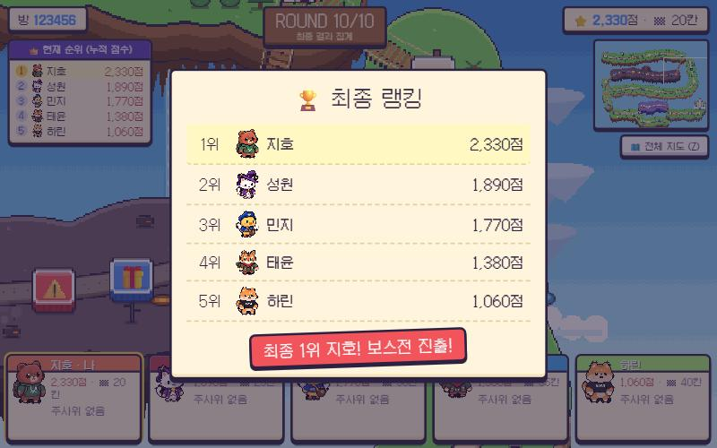
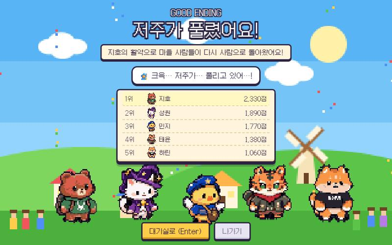
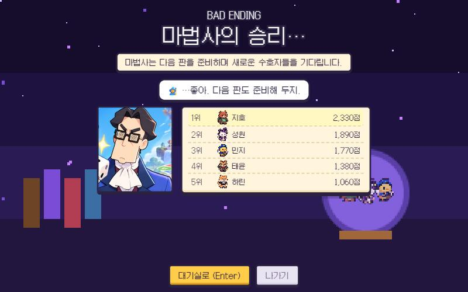

# RE:ROLL 🎲
### AI-Powered 5-Player Fantasy Party Game

> 승부는 미니게임에서, 역전은 주사위에서.


[🎮 게임 플레이](https://reroll-party.onrender.com/party/) · [🎬 오프닝 영상](party-python/board/assets/intro.mp4) · [📖 미니게임 통신 규격](party-python/docs/COMMON_SPEC.md)

RE:ROLL은 **5명이 각자의 기기에서 참여하는 2D 판타지 파티게임**입니다. 주사위로 보드 위를 이동하고 이벤트를 경험하며, 다양한 AI 기술을 활용한 **미니게임 20종 중 무작위로 선정되는 게임**을 통해 점수를 쌓습니다. **매 라운드 탈락자는 없으며 다섯 명 모두 끝까지 플레이합니다.** 게임 종료 시 **누적 점수 1위가 마법사 보스전에 진출**하고 승패에 따라 엔딩이 달라집니다.

> [!NOTE]
> Render 무료 배포 환경에서는 장시간 접속이 없으면 서버가 중지되어 첫 접속에 시간이 걸릴 수 있습니다. 카메라·마이크를 사용하는 미니게임은 브라우저 권한 허용이 필요합니다.

---

## 🪄 세계관 · 스토리

평화로운 마을에 사람들이 동물로 변하는 저주가 퍼집니다. 저주에 걸린 다섯 수호자—쿼카를 닮은 곰, 호랑이, 오리, 고양이, 시바견—는 마을을 되돌릴 방법을 찾아 마법사의 성으로 향합니다.

하지만 수호자들이 의지하려던 마법사가 바로 **저주를 만들어 낸 장본인**. 수호자들은 마법사가 준비한 주사위와 미니게임을 거치며 운명을 건 대결에 뛰어듭니다.

- **GOOD ENDING:** 최종 1위가 마법사를 이기고 저주를 풀어 마을 사람들이 인간의 모습으로 돌아옵니다.
- **BAD ENDING:** 마법사를 이기지 못하면 저주는 계속되고, 마법사는 새로운 수호자들을 기다리며 다음 게임을 준비합니다.

## 🗺️ 게임 진행 흐름

```text
타이틀 화면 (시작하려면 터치하세요)
  ↓
스토리 오프닝 영상 (SKIP 가능)
  ↓
방 만들기 / 팀 코드 입력 / 5인 대기실 / 캐릭터 선택
  ↓
주사위 굴리기 → 보드 이동 → 타일 이벤트
  ↓
랜덤 미니게임 → 플레이어별 결과 → 누적 점수 반영
  ↓
다음 턴 · 새로운 이벤트 · 새로운 미니게임 (전원 계속 참여)
  ↓
전체 게임 종료 → 누적 점수 최종 1위 결정
  ↓
최종 1위 vs 마법사 보스전
  ├─ 승리 → GOOD ENDING
  └─ 패배 → BAD ENDING
```

### 핵심 규칙

| 구분 | 내용 |
| --- | --- |
| 참가 방식 | 5인 멀티플레이, 각자 브라우저에서 접속 |
| 플레이 방식 | 보드 이벤트 + 랜덤 선정 미니게임 |
| 미니게임 규모 | 20종 등록, 매 게임 일부를 선정해 진행 |
| 경쟁 방식 | 동시 경쟁, 개인별 점수 비교, 팀 대결 등 게임마다 다름 |
| 탈락 | **라운드별 탈락 없음. 5명 모두 끝까지 참여** |
| 최종 진출 | **누적 점수 1위만 마법사 보스전 도전** |
| 엔딩 | 보스전 승패에 따라 굿 엔딩 / 배드 엔딩 |

## 🧠 AI와 게임플레이

게임마다 조작법과 판정 기준을 다르게 설계했습니다. 일부 미니게임은 AI 인식·평가를 활용해 단순한 버튼 조작 이상의 도전 경험을 제공합니다.

| 유형 | 적용 예시 |
| --- | --- |
| 🎤 음성 인식 | 음성 퀴즈, 주문을 외쳐라, 소리 따라하기 |
| ✋ 카메라·동작 인식 | 과일자르기, 가든 디펜스, 레이싱의 카메라 입력 |
| 🎨 그리기 | 마법진 그리기 |
| 🎵 타이밍·리듬 | 잭팟 그루브, 픽셀 줄다리기 |
| 🥊 대결·반응 | 손바닥 밀치기, 매직 파이트 나이트, 검도 |
| 🎲 파티게임 | 인형뽑기, 볼링, 홈런 더비, 하노마노 등 |

### 미니게임 20종

| | 게임 | | 게임 |
| --- | --- | --- | --- |
| 01 | 픽셀 줄다리기 | 11 | 잭팟 인형뽑기 |
| 02 | 손바닥 밀치기 | 12 | 매직 파이트 나이트 |
| 03 | 음성 퀴즈 | 13 | 하노마노 |
| 04 | 주문을 외쳐라 | 14 | 잭팟 볼링 |
| 05 | 무궁화 꽃이 피었습니다 | 15 | 잭팟 그루브 |
| 06 | 소리 따라하기 | 16 | 잭팟 홈런 더비 |
| 07 | 과일자르기 | 17 | 실거리 사격 |
| 08 | 가든 디펜스 | 18 | 마법진 그리기 |
| 09 | 검도 | 19 | 잭팟 탁구왕 |
| 10 | 레이싱 | 20 | 교수님 몰래 댄스! |

미니게임 목록은 실제 게임 등록 파일 [`party-python/web/src/games/registry.js`](party-python/web/src/games/registry.js)를 기준으로 작성했습니다. 미니게임의 AI 적용 방식과 입력 장치는 게임별로 다르며, 카메라나 마이크 대신 키보드로 대체 가능한 게임도 있습니다.

## 📸 게임 화면 미리보기

### 메인 이미지와 미니게임

| 메인 비주얼 | 미니게임 화면 예시 (매직 파이트 나이트) |
| :---: | :---: |
|  |  |

| 미니게임 결과 화면 예시 | 최종 순위 화면 |
| :---: | :---: |
|  |  |

### 보스전과 두 가지 엔딩

| 보스전 진입 | GOOD ENDING | BAD ENDING |
| :---: | :---: | :---: |
|  |  |  |

### 🎬 실제 저장소의 영상 자료

- [오프닝 애니메이션 보기 — intro.mp4](party-python/board/assets/intro.mp4)
- [굿 엔딩 애니메이션 보기 — ending-good.mp4](party-python/board/assets/ending-good.mp4)
- [배드 엔딩 애니메이션 보기 — ending-bad.mp4](party-python/board/assets/ending-bad.mp4)

> GitHub README에서는 위 MP4를 링크로 제공하고, 핵심 장면은 이미지로 미리 볼 수 있도록 구성했습니다. 전체 5인 플레이 녹화 영상은 저장소에서 확인되는 파일이 없어 추후 별도로 추가할 수 있습니다.

## 🛠️ 기술 스택

| 영역 | 기술 / 도구 | 적용 내용 |
| --- | --- | --- |
| Frontend | JavaScript, HTML, CSS, Vite | 보드 · 로비 · 미니게임 UI |
| Backend | Python, FastAPI, Uvicorn | 서버 API · 게임 상태 · 미니게임 판정 |
| 실시간 통신 | WebSocket | 방 및 플레이어 상태, 게임 진행 동기화 |
| AI / 인식 | MediaPipe Tasks Vision, 음성 인식, Hugging Face 모델 등 | 카메라·마이크 기반 게임 입력 및 판정 |
| 생성형 AI | Gemini API | 음성 처리 및 일부 미니게임 기능 연동 |
| 콘텐츠 제작 | Wan 2.2, PixVerse, Suno 등 | 오프닝 영상 · 이미지 애니메이션 · 음악 제작 |
| 배포 · 협업 | Docker, Render, GitHub | 웹 서비스 배포와 팀 개발 |

AI 기능은 각 미니게임의 구현 방식과 배포 환경에 따라 사용 모델 및 대체 입력 방식이 다릅니다. 모델과 실행 규칙은 개별 게임 코드에서 확인할 수 있습니다.

## 👥 팀 구성 및 담당

| 팀원 | 담당 | 주요 작업 |
| --- | --- | --- |
| 동주 · 용학 | 미니게임 제작 | 각 10종 제작, 게임 구성, AI 기능 및 1차 테스트 |
| 민재 | 미니게임 검수 · AI 보완 | 추가 AI 기능 배치, 게임 정비, 2차 테스트 |
| 대환 | 서버 · 이벤트 | 5인 방, 실시간 동기화, 점수 및 보드 이벤트 |
| 세은 (팀장) | 총괄 · 최종 통합 | 게임 전체 흐름, 스토리보드, UI, 오프닝·엔딩, 시스템 통합 및 최종 테스트 |

## 🗂️ 저장소 구조

```text
RE-ROLL/
├── README.md
├── party-python/          # 현재 Render 배포 기준 통합 프로젝트
│   ├── board/             # 메인 화면 · 보드 · 인트로 · 보스전 · 엔딩
│   │   └── assets/        # keyart, 캐릭터, intro/ending 영상
│   ├── web/               # Vite 기반 미니게임 프론트엔드
│   │   └── src/games/     # 미니게임 20종 등록 및 화면 구현
│   ├── server/            # FastAPI · WebSocket · 게임 판정
│   └── docs/              # 통신 규격 · 배포 문서 · 화면 자료
├── party/                 # 별도 보드 UI 구현
├── server/                # Node 기반 별도 서버 구현
├── minigame-KMJ/          # 미니게임 별도 개발 자료
├── [기타 미니게임 폴더]   # 개별 게임 원본 및 실험 코드
└── render.yaml            # Render Docker 배포 설정
```

## 🚀 실행 및 배포

### 온라인 플레이

**[RE:ROLL 플레이하기](https://reroll-party.onrender.com/party/)**

1. 메인 이미지를 터치해 시작합니다.
2. 인트로 영상 시청 또는 건너뛰기를 선택합니다.
3. 방을 만들거나 팀 코드를 입력해 입장합니다.
4. 5명이 접속한 뒤 보드·이벤트·랜덤 미니게임을 진행합니다.
5. 누적 점수 1위의 보스전과 엔딩을 확인합니다.

### 로컬 실행 및 상세 문서

- [통합 프로젝트 실행 안내](party-python/README.md)
- [Render 배포 안내](party-python/docs/deploy.md)
- [미니게임 공통 통신 규격](party-python/docs/COMMON_SPEC.md)

Render 배포는 루트의 [`render.yaml`](render.yaml)과 `party-python/Dockerfile`을 사용합니다. API 키와 같은 민감한 정보는 코드에 직접 기록하지 않고 배포 환경 변수로 관리합니다.

## 🌿 협업 방식

| 브랜치 | 목적 |
| --- | --- |
| `main` | 최종 배포용 |
| `develop` | 팀 통합 개발 |
| `feature/*` | 팀원별 기능 개발 및 검증 |

기능 개발은 개별 브랜치에서 진행하고, Pull Request로 검토한 뒤 통합하는 방식을 사용합니다.

---

<p align="center">🎲 <strong>RE:ROLL — 승부는 미니게임에서, 역전은 주사위에서.</strong></p>
